# Mars Cosmetics — Order & Inventory Sync Service

 1. Overview and goals

Goal: Keep orders and inventory consistent across the company website, Nykaa, Flipkart and Blinkit, while delivering every confirmed order to Microsoft Business Central ERP.

Design priorities
- Prevent the same physical unit from being reserved for multiple orders.
- Keep channel stock close to sellable warehouse stock; target updates within 60 seconds during normal operation.
- Persist orders and pending work so temporary outages do not lose them.
- Keep channel integrations independent so one channel or ERP outage does not stop the others.
- Provide an audit trail and an operations view for failed synchronizations and retries.

Proposed stack: NestJS services on AWS compute, PostgreSQL as the system of record, AWS SQS for durable asynchronous work, Redis for rate limiting/cache where useful, and CloudWatch for logs, metrics and alerts. Keep the first version small enough for three developers and a six-week delivery.

# 2. Architecture and data flow

```mermaid
flowchart LR
    subgraph Channels["Sales channels"]
      WEB["Own website<br/>Webhook / API"]
      NYK["Nykaa<br/>Webhook"]
      FLIP["Flipkart<br/>Polling"]
      BLINK["Blinkit<br/>Webhook / REST / CSV"]
    end

    API["NestJS ingestion<br/>Adapters + validation"]
    DB[("PostgreSQL<br/>Orders, inventory, inbox/outbox, audit")]
    OUT["Outbox dispatcher"]
    Q[["AWS SQS<br/>Durable jobs + DLQ"]]
    RES["Order processor<br/>Atomic reservation"]
    SYNC["Channel sync workers<br/>Per-channel throttles"]
    ERPW["ERP delivery worker"]
    ERP["Microsoft Business Central"]
    OPS["Ops dashboard<br/>Failed jobs / retry"]
    REDIS[("Redis<br/>Rate limits / cache")]
    MON["CloudWatch<br/>Logs, metrics, alerts"]

    WEB --> API
    NYK --> API
    BLINK --> API
    FLIP --> API
    API --> DB
    DB --> OUT
    OUT --> Q
    Q --> RES
    RES <--> DB
    Q --> SYNC
    SYNC --> WEB
    SYNC --> NYK
    SYNC --> FLIP
    SYNC --> BLINK
    Q --> ERPW
    ERPW --> ERP
    REDIS -.-> API
    REDIS -.-> SYNC
    DB --> OPS
    Q --> OPS
    API -.-> MON
    RES -.-> MON
    SYNC -.-> MON
    ERPW -.-> MON
```

*Flow
1. Channel adapters accept webhooks or run scheduled polling; each converts the channel payload into a canonical event/order shape.
2. Persist the incoming event in PostgreSQL's inbox before acknowledging receipt. Enforce deduplication constraints.
3. A processor validates the order and reserves all requested SKU quantities in one PostgreSQL transaction. Record the order, reservation and inventory-ledger entries together.
4. Write an outbox event in the same transaction. A dispatcher publishes it to SQS; workers can safely retry jobs.
5. Independent workers publish desired stock snapshots to each channel and send confirmed orders to Business Central.
6. The operations view displays failed jobs, queue age, last successful sync and retry controls. A retry reuses the same stable job/order identity.

**Deployment:** Run the NestJS ingestion service and background workers as separate AWS ECS services (or a comparably simple managed compute option). Use managed PostgreSQL sized to the workload, SQS, and a small Redis deployment only if needed for coordination/rate limits. Confirm actual AWS pricing before provisioning; keep within the approximately ₹50,000/month budget. Do not introduce Kubernetes or a separate streaming platform in v1.

# 3. Data model and idempotency

| Table | Key fields and constraints | Purpose |
|---|---|---|
| `products` | `sku` primary key, `name`, `active` | Canonical product catalogue |
| `inventory` | `sku` primary/foreign key, `on_hand`, `reserved`, `updated_at`; check `0 <= reserved <= on_hand` | Current warehouse quantities |
| `orders` | internal ID primary key, `channel`, `external_order_id`, `status`; unique (`channel`, `external_order_id`) | Canonical orders |
| `order_items` | `order_id`, `sku`, `qty`, `unit_price`; unique (`order_id`, `sku`) if repeated SKU lines are consolidated | Order lines |
| `inventory_reservations` | order ID, SKU, quantity, status; unique reservation per order/SKU | Tracks reserved, released or committed quantities |
| `inventory_ledger` | SKU, signed quantity change, reason, order ID, timestamp, correlation ID | Append-only audit of stock movements |
| `inbox_events` | channel, stable event key, payload, received time, processing status; unique (`channel`, `event_key`) | Deduplicates inbound events |
| `outbox_events` | event ID, type, aggregate ID, payload, publish status | Bridges database transaction to queue |
| `sync_jobs` | channel, SKU or batch key, desired quantity, status, attempts, next retry time | Channel stock publication and retry state |
| `erp_deliveries` | order ID unique, status, ERP reference, attempts, last error | Tracks ERP delivery |

*Idempotency rules**
- The unique order key prevents duplicate order records; the inbox key prevents repeated processing of the same source event.
- Deduplication alone is not enough: reservation/release/commit transitions must be conditional on the current order and reservation state, so the same event cannot change stock twice.
- Use a stable internal order ID as the ERP idempotency key, or a unique external reference supported by Business Central. On an ambiguous timeout, check whether the order already exists before attempting creation again.
- The inventory ledger is append-only; corrections are new compensating entries, not edits to history.

# 4. Ingestion, event ordering and stock consistency

*Webhooks and polling*
- Own website, Nykaa and Blinkit: validate and persist webhook events, then acknowledge quickly.
- Flipkart: poll at the permitted two-minute interval; save a durable cursor/checkpoint and use overlap where practical so a restart does not skip orders.
- Normalize channel-specific fields into a canonical order model. Keep the original payload for support/audit, with access controls and retention limits.
- For duplicate events, use inbox and order unique constraints. For out-of-order events, apply only valid state transitions; prefer a source version/sequence or a fresh source-status lookup where supported. Do not assume event arrival time alone determines the newest state.
- If a source is temporarily unavailable, resume from the last durable checkpoint or retry webhooks/reconciliation when it recovers. Do not claim to recover events a channel never delivers unless its API supports replay or polling.

*Atomic stock reservation*
Available stock is `on_hand - reserved`. Use PostgreSQL as the authority; Redis is not the stock authority. Reserve each order's complete set of SKUs in one transaction. A conditional update atomically increases `reserved` only if sufficient available stock remains. If any line cannot be reserved, roll back the full reservation and mark the order for the appropriate exception/cancellation flow. Lock/update SKU rows in a consistent SKU order to reduce deadlocks.

*Concurrency example:* one unit remains; Nykaa and Flipkart orders each request it at the same moment. The first conditional update succeeds and reserves the unit. PostgreSQL serializes the competing update; its condition is then re-evaluated against the latest row, so the second reservation returns no row and fails. This prevents the internal system from allocating the same unit twice.

A marketplace may already have accepted an order before its event reaches us. The service cannot prevent that remote acceptance retroactively; it must flag the shortage, attempt the channel's cancellation/exception workflow, and reconcile. Conservative channel stock buffers and rapid stock publication reduce this risk but do not replace atomic reservation.

**Cancellation and returns**
- A cancellation before dispatch releases the reservation once.
- On dispatch, commit the reservation and decrement `on_hand` and `reserved` according to the fulfillment transition.
- A returned item is added back to sellable stock only after warehouse receipt/inspection confirms it is resalable.
- Every transition writes an audit-ledger entry and is idempotent.

# 5. Channel stock sync and failure handling

Publish **desired stock snapshots**, not blind increment/decrement commands. Coalesce pending stock jobs by channel/SKU so a newer quantity supersedes an older unsent snapshot; never coalesce away order events or ledger history. Use independent channel queues/workers and rate limiters.

| Channel | Contract / strategy |
|---|---|
| Own website | Direct API/database update; route changes through the same inventory authority |
| Nykaa | One SKU per REST call; throttle to at most 5 requests/second |
| Flipkart | Bulk up to 50 SKUs; throttle to at most 10 requests/second and respect HTTP 429 / `Retry-After` |
| Blinkit | REST for urgent changes; handle about 2% timeouts with bounded retries and reconciliation; use daily CSV for bulk reconciliation |

Target channel updates within 60 seconds under normal load. This is an objective, not a guarantee during provider outages or when API capacity is exceeded. Nykaa's theoretical maximum is 300 SKU calls/minute before latency/retries, so prioritize changed SKUs, coalesce pending snapshots, monitor lag and use a conservative stock buffer. A daily CSV is not sufficient for the 60-second target; Blinkit's REST API is needed for urgent updates.

*Retries and isolation
- Retry transient network errors, timeouts and 5xx with exponential backoff and jitter. Respect `Retry-After` for 429s. Use bounded retries before dead-lettering.
- ERP maintenance: retain confirmed orders and pending ERP deliveries durably; retry with backoff after recovery. ERP delivery runs independently from channel sync.
- Blinkit timeout: treat the outcome as unknown; retry an idempotent “set quantity” operation and reconcile current remote quantity where possible.
- Permanently failing jobs go to a dead-letter queue/failed state, raise an alert, and appear in the ops screen for investigation and safe retry.
- Use a transactional outbox: commit order, reservation, ledger and outbox entry together, then publish to SQS. SQS delivery is at-least-once, so workers must be idempotent.
- “Exactly once” ERP effects require ERP-supported idempotency or a unique searchable external reference. Without that capability, the design can ensure durable retries and avoid duplicates when detectable, but cannot mathematically guarantee exactly-once effects across an external timeout.

# 6. Observability, scope, assumptions and trade-offs

*Day-one metrics / alerts
1. Reservation failures and orders flagged for insufficient stock.
2. Per-channel stock-sync lag (age of oldest pending update; alert as it approaches 60 seconds).
3. Queue depth/oldest message age, retry counts and dead-letter queue size.
4. Confirmed orders awaiting ERP acknowledgement and age of oldest pending delivery.
5. Inventory reconciliation discrepancies and repeated channel API errors/429s.

Use structured logs with correlation ID, channel, external order ID, SKU and job ID. Do not log credentials or unnecessary customer data.

*Assumptions
- Each channel SKU maps to one canonical internal SKU.
- PostgreSQL is the authoritative record for reservations and sellable stock.
- The service can persist incoming events before acknowledging them.
- Business Central can accept an idempotency key or a unique external order reference that can be searched after an ambiguous timeout; validate this during integration discovery.
- Channel status lookup/replay/reconciliation is available where needed; where not available, recovery is limited to what that channel exposes.
- `on_hand` represents physical stock; damaged/unsellable returns are excluded.
- “Confirmed order” means an order accepted by the channel and successfully reserved internally; exact confirmation semantics must be agreed per channel.
- The 60-second target applies during normal operation and depends on external API availability and rate limits.

*Trade-offs

| Decision | Chosen | Rejected | Why |
|---|---|---|---|
| Inventory correctness | PostgreSQL transaction + conditional update | Redis-only lock or cached stock | Database enforces atomic reservations alongside order state |
| Async work | AWS SQS + outbox | Synchronous external calls / self-managed broker | Durable retries with low operational overhead |
| ERP delivery | Durable delivery record, retries and idempotency | Single direct call without tracking | Survives Sunday outage and ambiguous timeouts |
| Channel sync | Independent workers, per-channel throttles and batching | One shared unthrottled worker | One provider's limit/outage does not block others |
| Stock updates | Coalesced desired-quantity snapshots | Send every intermediate quantity | Reduces API calls while preserving latest channel stock target |

*V1 scope (six weeks, three developers)
- Include canonical order ingestion, atomic reservation, cancellation/release lifecycle, channel sync workers, ERP delivery/retries, audit history, basic operations retry screen and essential alerts.
- Leave out multi-warehouse allocation, forecasting/replenishment, an LLM assistant, advanced analytics, and a complex event-streaming platform. Revisit only after v1 metrics justify them.

*AI usage note: “ChatGPT was used to help structure and review this design document; the author reviewed the proposed decisions and is responsible for understanding and defending them.”
